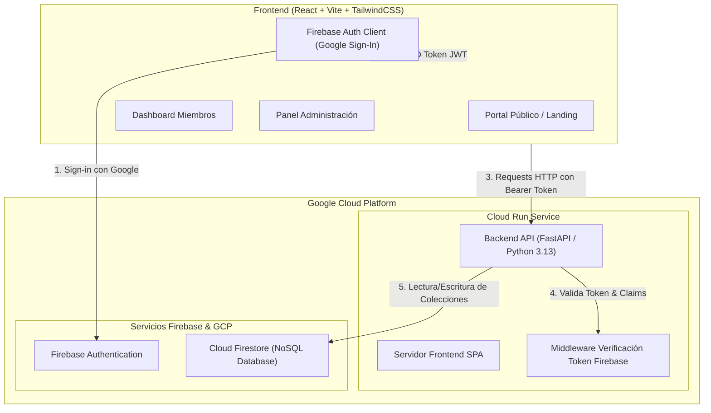

# Plan de Desarrollo: Portal Web Oficial Comunidad GCP

**Proyecto:** Comunidad GCP - Plataforma Web de Gestión y Colaboración  
**Entorno de Ejecución:** Google Cloud Run  
**Autenticación:** Firebase Authentication (Google / Gmail Provider)  
**Base de Datos:** Cloud Firestore  
**Diseño & UI/UX:** Generado con Stitch MCP (Sistema de Diseño: *Cloud Horizon Developer Console*)  
**Fecha:** Octubre 2026  

---

## 1. Visión y Objetivos

La **Comunidad GCP** congrega a múltiples arquitectos, líderes técnicos e ingenieros de diversas empresas que diseñan e implementan soluciones sobre Google Cloud Platform. La comunidad realiza actividades de capacitación continua, charlas técnicas periódicas, análisis de novedades de producto, newsletters especializadas y encuentros presenciales.

El presente proyecto implementa el portal oficial de la comunidad, permitiendo:
1. **Público General (No Registrado):** Conocer la propuesta de valor de la comunidad, estadísticas clave, agenda general y registrarse utilizando su cuenta de Google (Gmail / Workspace).
2. **Miembros Registrados:**
   - Visualizar charlas pendientes (fecha, hora, ponente, temario, enlace/ID de Google Meet).
   - Explorar archivo histórico de charlas impartidas con acceso a grabaciones (YouTube / Drive).
   - Acceder al feed de noticias y lanzamientos de productos de Google Cloud.
   - Leer y descargar periódicamente ediciones del Newsletter oficial de novedades GCP.
   - Consultar eventos presenciales programados (sede, fecha, agenda, enlace de inscripción).
   - Participar en el espacio comunitario de preguntas, debates técnicos y comentarios.
3. **Administradores:**
   - Panel de control integral (CRUD de Charlas y grabaciones, Newsletters, Noticias GCP, Eventos presenciales).
   - Gestión de usuarios y asignación de roles.
   - Moderación y respuesta directa a preguntas y comentarios comunitarios.

---

## 2. Arquitectura de la Solución



### Componentes Principales:
- **Frontend SPA:** Desarrollado en React con Vite, Tailwind CSS y Lucide Icons. Diseñado con soporte de Stitch MCP siguiendo la guía visual oficial de Google Cloud Console.
- **Backend API:** Desarrollado con FastAPI (Python 3.13), estructurado en capas (routers, schemas Pydantic, servicios de Firestore y autenticación).
- **Persistencia Firestore:** Colecciones NoSQL optimizadas para lectura rápida y consultas compuestas con timestamps e índices.
- **Seguridad:** Verificación del token ID emitido por Firebase Authentication en cada llamada protegida; validación de rol de administrador mediante Firestore y custom claims.
- **Despliegue Cloud Run:** Empaquetado en un contenedor Docker optimizado (multi-stage build), sin privilegios de root, con health checks (`/health`) y variables de entorno dinámicas.

---

## 3. Identidad Visual y Diseño UI/UX (Stitch MCP)

El diseño conceptual y tokens de estilo fueron generados mediante el proyecto Stitch MCP **`Comunidad GCP Portal`** (*Cloud Horizon Developer Console*):

- **Fondo / Canvas:** Midnight Slate `#0B1326`, `#0E172A`, `#131D35`.
- **Acentos Google Cloud:**
  - Azul GCP (`#4285F4`): Botones de acción principal, pestañas activas, enlaces interactivos.
  - Verde GCP (`#34A853`): Estado de salud, eventos confirmados, indicadores de éxito.
  - Amarillo GCP (`#FBBC05`): Novedades destacadas, avisos y etiquetas de certificación.
  - Rojo GCP (`#EA4335`): Alertas, grabaciones en vivo, acciones destructivas.
- **Tipografía:**
  - Texto e interfaz: `Inter` (alta legibilidad técnica).
  - Identificadores, ID de Meet, badges y código: `JetBrains Mono`.
- **Estilo:** Glassmorphism sutil con bordes translúcidos (`1px solid #2A385B`), elevación por capas y micro-interacciones suaves.

---

## 4. Modelo de Datos en Cloud Firestore

### 4.1. Colección `charlas` (`talks`)
```json
{
  "id": "charla-2026-10-15",
  "titulo": "Arquitecturas Serverless y Cloud Run a Escala",
  "descripcion": "Patrones avanzados de escalabilidad, concurrencia y VPC Serverless Access.",
  "ponente": "Ing. Martín Morales - Google Cloud Champion Innovator",
  "fecha_hora": "2026-10-15T19:00:00Z",
  "estado": "pendiente", // "pendiente" | "realizada" | "cancelada"
  "meet_id": "meet.google.com/gcp-com-arch",
  "grabacion_url": "https://youtube.com/watch?v=ejemplo",
  "material_url": "https://github.com/comunidadgcp/charla-cloudrun",
  "tags": ["Cloud Run", "Serverless", "Arquitectura"],
  "creado_en": "2026-10-01T12:00:00Z"
}
```

### 4.2. Colección `noticias` (`news`)
```json
{
  "id": "noticia-001",
  "titulo": "Lanzamiento de Gemini 3.8 en Vertex AI",
  "resumen": "Nuevas capacidades multimodales y reducción del 40% en latencia de inferencia.",
  "contenido_completo": "Detalle técnico de los nuevos endpoints...",
  "categoria": "IA & Machine Learning",
  "fuente_url": "https://cloud.google.com/blog/products/ai-machine-learning",
  "publicado_por": "Admin Comunidad",
  "fecha_publicacion": "2026-10-05T14:30:00Z",
  "destacada": true
}
```

### 4.3. Colección `newsletters`
```json
{
  "id": "newsletter-edicion-12",
  "numero_edicion": 12,
  "titulo": "Newsletter Octubre 2026: Novedades Cloud Next y FinOps",
  "resumen": "Resumen mensual de releases, mejores prácticas y notas arquitectónicas de la comunidad.",
  "contenido_markdown": "## Editorial\nEste mes revisamos...",
  "documento_url": "https://storage.googleapis.com/comunidadgcp-newsletters/edicion-12.pdf",
  "autor": "Equipo Editorial Comunidad GCP",
  "fecha_emision": "2026-10-01T10:00:00Z"
}
```

### 4.4. Colección `eventos` (`events`)
```json
{
  "id": "evento-presencial-2026-11",
  "nombre": "GCP Cloud Summit & Networking Presencial",
  "descripcion": "Jornada técnica con mesas redondas, networking y sesión de arquitectura práctica.",
  "fecha_hora": "2026-11-20T17:30:00Z",
  "lugar": "Auditorio Google Buenos Aires / Latam Hub (Piso 5)",
  "cupos_disponibles": 120,
  "link_registro": "https://forms.gle/evento-presencial-gcp-2026",
  "estado": "abierto",
  "creado_en": "2026-10-02T08:00:00Z"
}
```

### 4.5. Colección `usuarios` (`users`)
```json
{
  "uid": "firebase_auth_uid_123",
  "email": "usuario@gmail.com",
  "nombre": "Carlos Gómez",
  "foto_url": "https://lh3.googleusercontent.com/...",
  "empresa": "Tech Solutions SA",
  "rol_profesional": "Cloud Solutions Architect",
  "rol": "admin", // "admin" | "miembro"
  "activo": true,
  "fecha_registro": "2026-10-01T10:00:00Z",
  "ultimo_acceso": "2026-10-07T16:00:00Z"
}
```

### 4.6. Colección `comentarios` (`comments`)
```json
{
  "id": "pregunta-501",
  "uid_autor": "firebase_auth_uid_123",
  "nombre_autor": "Carlos Gómez",
  "email_autor": "usuario@gmail.com",
  "foto_autor": "https://lh3.googleusercontent.com/...",
  "titulo": "¿Cómo recomiendan estructurar el Multi-Project VPC Peering con PSC?",
  "contenido": "Estamos migrando una plataforma bancaria hacia GCP...",
  "categoria": "Redes & Seguridad",
  "respuestas": [
    {
      "id_respuesta": "resp-1",
      "uid_autor": "admin_uid_789",
      "nombre_autor": "Martín Morales (Admin)",
      "contenido": "Lo más aconsejable es usar Private Service Connect (PSC) endpoints...",
      "es_admin": true,
      "fecha": "2026-10-07T12:00:00Z"
    }
  ],
  "fecha_creacion": "2026-10-06T18:00:00Z"
}
```

---

## 5. Especificación de la API Backend (FastAPI)

- `GET /health`: Comprobación de salud requerida para Google Cloud Run.
- **Módulo Charlas:**
  - `GET /api/v1/charlas`: Lista charlas pendientes y realizadas (filtro por estado).
  - `POST /api/v1/charlas`: [Admin] Crea una nueva charla.
  - `PUT /api/v1/charlas/{id}`: [Admin] Actualiza datos o agrega enlace de grabación.
  - `DELETE /api/v1/charlas/{id}`: [Admin] Elimina una charla.
- **Módulo Noticias:**
  - `GET /api/v1/noticias`: Listado de novedades de GCP con paginación.
  - `POST /api/v1/noticias`: [Admin] Publica nueva noticia.
  - `DELETE /api/v1/noticias/{id}`: [Admin] Elimina una noticia.
- **Módulo Newsletters:**
  - `GET /api/v1/newsletters`: Listado de ediciones y documentos PDF/Markdown.
  - `POST /api/v1/newsletters`: [Admin] Carga una nueva edición del newsletter.
- **Módulo Eventos Presenciales:**
  - `GET /api/v1/eventos`: Lista de eventos presenciales abiertos y pasados.
  - `POST /api/v1/eventos`: [Admin] Crea evento presencial con sede y link de registro.
  - `PUT /api/v1/eventos/{id}`: [Admin] Actualiza estado o detalles.
- **Módulo Foro y Preguntas:**
  - `GET /api/v1/comentarios`: Lista hilos de discusión y consultas técnicas.
  - `POST /api/v1/comentarios`: [Miembro] Publica una nueva consulta o comentario.
  - `POST /api/v1/comentarios/{id}/respuestas`: [Miembro/Admin] Responde a un hilo.
- **Módulo Usuarios:**
  - `POST /api/v1/usuarios/sincronizar`: Sincroniza datos del perfil luego de Google Sign-in.
  - `GET /api/v1/usuarios`: [Admin] Lista los miembros registrados.
  - `PATCH /api/v1/usuarios/{uid}/rol`: [Admin] Asigna rol de miembro o admin.

---

## 6. Fases de Ejecución

- [x] **Fase 1:** Especificación del Plan y Documento de Arquitectura (`PLAN_DE_DESARROLLO.md`).
- [x] **Fase 2:** Definición del Sistema de Diseño en Stitch MCP y extracción de tokens de interfaz.
- [ ] **Fase 3:** Estructuración e Implementación del Backend FastAPI con Firestore y Firebase Auth.
- [ ] **Fase 4:** Desarrollo del Frontend React SPA interactivo con temas visuales Google Cloud Console.
- [ ] **Fase 5:** Integración de datos iniciales (Seed Data), Contenerización Docker para Cloud Run y Pruebas.
